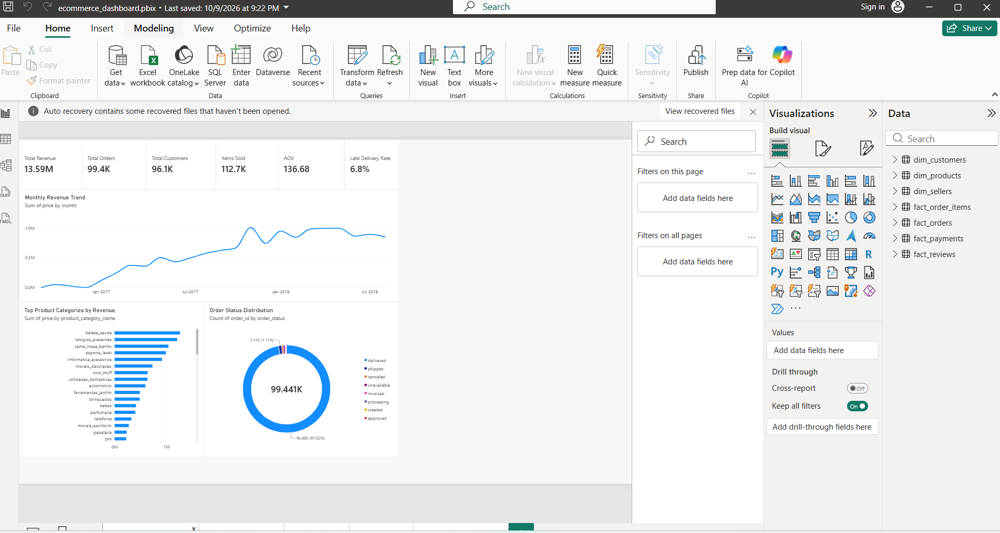
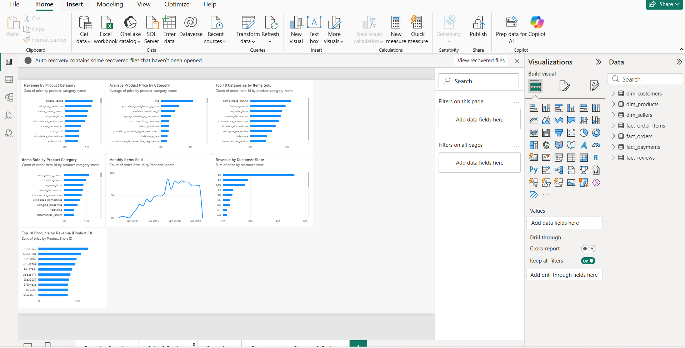
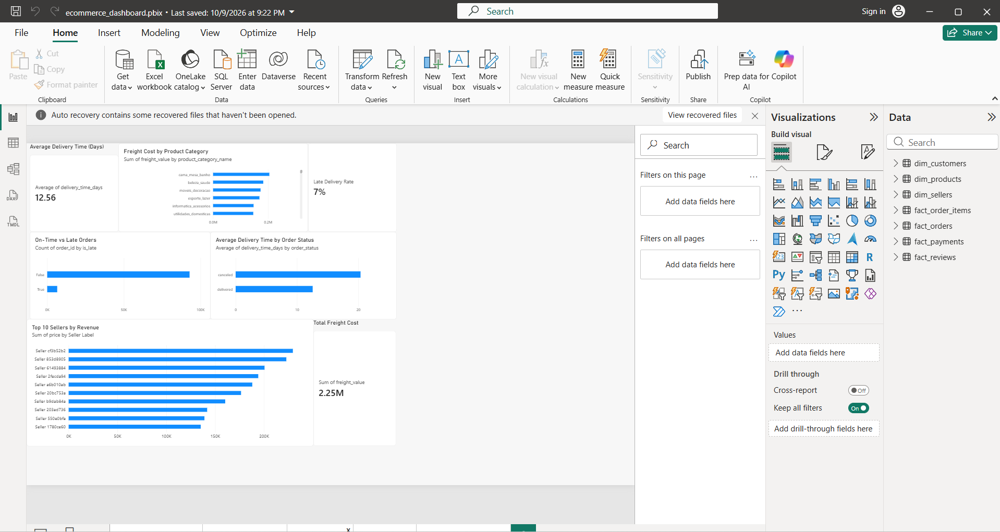
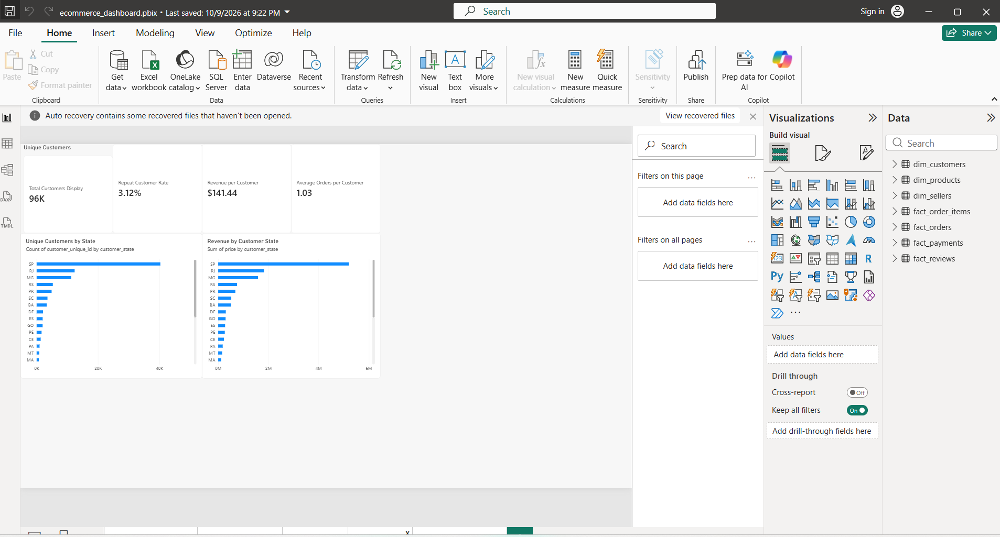
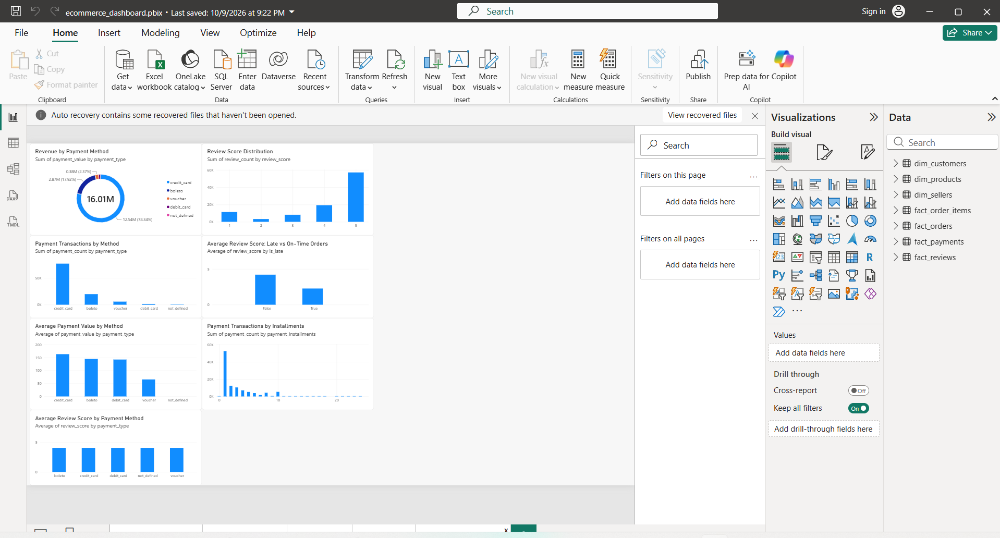

# E-Commerce Analytics Platform

## Project Overview

This project analyzes the Brazilian E-Commerce Public Dataset by Olist to understand sales performance, customer behavior, product trends, payment methods, and delivery operations.

The goal is to transform transactional data into actionable business insights using Python, Pandas, Jupyter Notebook, SQL concepts, and Power BI.

## Business Questions

- How does revenue change over time?
- Which product categories generate the most revenue?
- Which states contribute the most customers and revenue?
- How often do customers make repeat purchases?
- How well does the business meet delivery expectations?
- How do payment methods and installment plans vary?
- How are delivery delays associated with customer review scores?

## Tools and Technologies

- Python and Pandas
- Jupyter Notebook
- Power BI and DAX
- CSV datasets
- Git and GitHub

## Dataset

The project uses the public [Brazilian E-Commerce Public Dataset by Olist](https://www.kaggle.com/datasets/olistbr/brazilian-ecommerce), covering transactions from 2016–2018.

The original raw data is not included in this repository. Please download it from the dataset source if you want to reproduce the analysis.

## Project Workflow

1. Load and explore the source datasets.
2. Clean and transform data using Python.
3. Prepare customer, product, seller, order, payment, item, and review tables.
4. Build relationships between the tables.
5. Create DAX measures and KPIs.
6. Develop a five-page Power BI dashboard.
7. Translate analytical results into business recommendations.

## Dashboard Pages

1. **Executive Overview** — revenue, orders, customers, items sold, average order value, and late delivery rate.
2. **Product & Sales** — category performance, product sales, pricing, and revenue by customer state.
3. **Operations** — delivery time, freight costs, late deliveries, and seller revenue.
4. **Customers** — customer distribution, repeat purchase rate, revenue per customer, and average orders per customer.
5. **Payment & Reviews** — payment methods, installment activity, review scores, and delivery performance.

## Key Results

- Product revenue: approximately R$13.59 million.
- Orders: 99,441.
- Items sold: 112,650.
- Average order value: approximately R$136.68.
- Late delivery rate: approximately 6.8%.
- Average delivery time: approximately 12.6 days.
- Repeat customer rate: approximately 3.1%.

Results are based on the current project calculations and may vary slightly depending on filters, definitions, and model changes.

## Business Insights

- Product revenue and payment transaction value are different metrics and should be analyzed separately.
- Delivery delays are associated with lower average customer review scores in this dataset; this association does not prove causation.
- Repeat purchasing is relatively uncommon, suggesting an opportunity to investigate customer retention.
- Category-level sales analysis can help identify products and categories that contribute most to revenue.
- Delivery and freight metrics can help identify operational areas for further investigation.

## Repository Structure

```text
ecommerce-analytics-platform/
├── data/
│   ├── raw/          # Download separately; not tracked by Git
│   └── processed/
├── notebooks/
│   └── 01_data_exploration.ipynb
├── reports/
│   └── figures/
├── dashboard/
├── sql/
├── README.md
├── business_insights.md
├── .gitignore
└── ecommerce_dashboard.pbix.pbix
```

The repository may contain additional supporting files.

## How to Explore

1. Read `notebooks/01_data_exploration.ipynb` to understand the analysis.
2. Review the processed tables in `data/processed/`.
3. Open `ecommerce_dashboard.pbix.pbix` with Power BI Desktop.
4. Explore the five report pages and compare the results.

## Limitations

This project analyzes historical transactions rather than live business data. Relationships between delivery performance and review scores are observational and do not establish causation.

## Author

Created as an e-commerce analytics portfolio project to demonstrate data preparation, analytical thinking, KPI development, data modeling, and dashboard design.

## Power BI Dashboard Preview

The dashboard contains five pages covering overall business performance, products and sales, delivery operations, customer behavior, and payment and review patterns.

### Executive Overview


### Product & Sales


### Operations


### Customers


### Payment & Reviews

